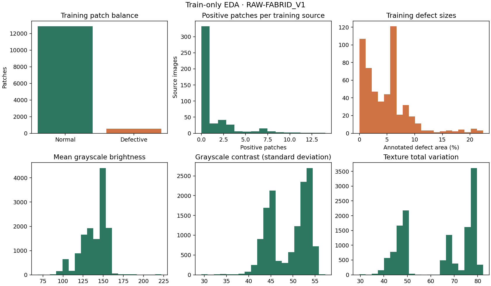
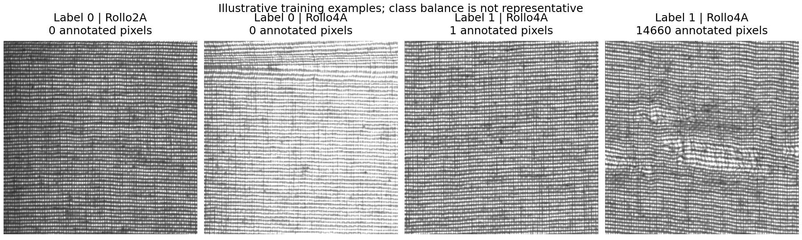
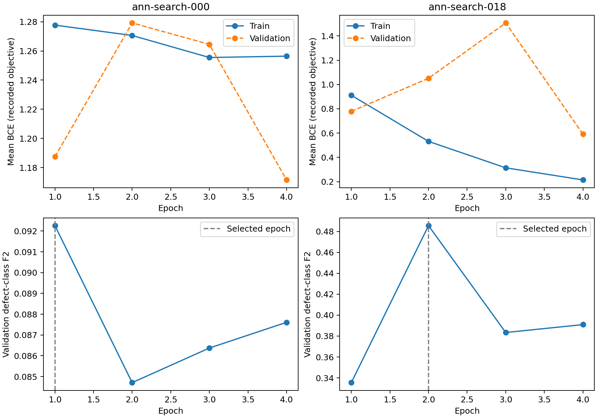
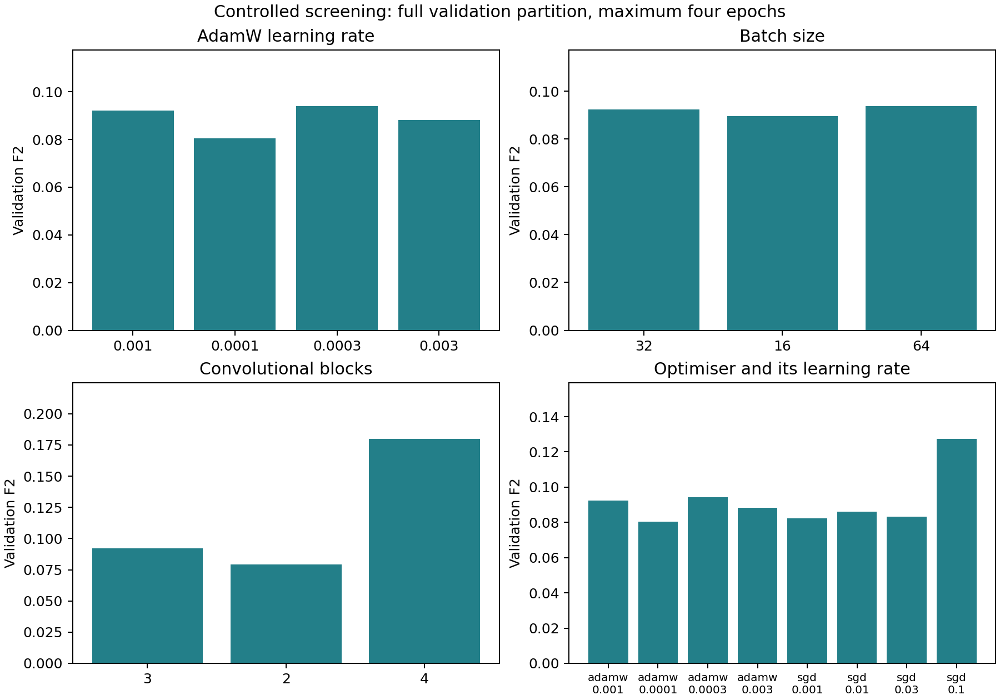
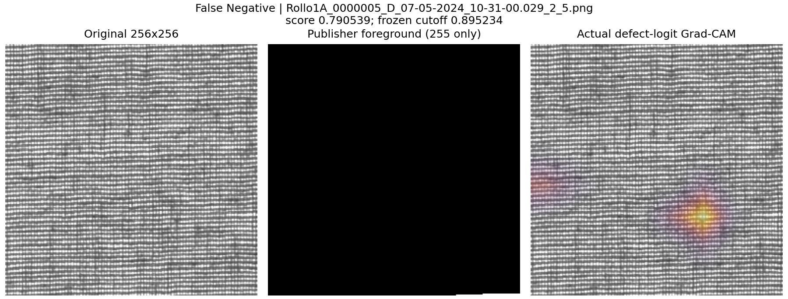
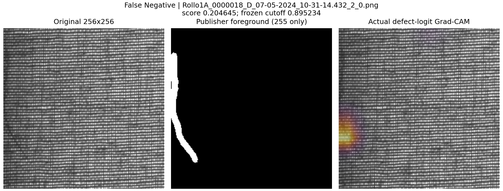
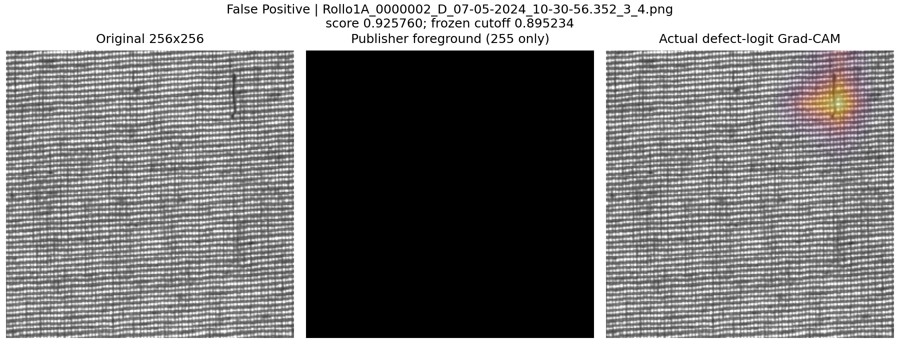

# Risk-aware, explainable fabric defect detection

Individual ANN coursework | RAW-FABRID V1 | Questions 1-6

A textile Quality Assurance Inspector submits a 256 x 256 fabric patch, reviews the trained model score and binary decision, then uses a Grad-CAM overlay to direct visual inspection. The inspector retains the release/hold decision. This system does not certify a complete roll or operate production machinery.

The approved dataset was recovered from the publisher, audited and evaluated using one frozen supervised split. The publisher training folder contains only normal patches; labelled patches were pooled and reassigned by the publisher fabric-origin field, source image and duplicate relationships before training. This is a new supervised protocol, not a benchmark result on the publisher anomaly-detection split.

| Evidence | Completed result |
| --- | --- |
| Full release | 19,852 patches; 687 defective; publisher SHA-256 verified |
| Training search | 21 ANN configurations; 28 classical configurations including four pilots; three selected-model seeds |
| Final population | All 2,996 held-out patches; 96 defective; same examples for ANN/SVM/VLM |
| Scientific failures | Four actual unsuccessful attempts, including two substantive approaches |
| XAI | Three genuine incorrect predictions; measured top/low/random occlusion |
| Engineering checks | 52 tests passed; real HTTP/browser checks and four notebooks passed |
| Presentation evidence | Actual application recording under eight minutes; individual live defence remains the student task |

Final ANN: ann-search-018, 1,518,881 parameters, test F2 0.6883. Tuned classical: svm-search-042, test F2 0.0623. The observed winner between these families is final ann. No choice was changed after observing test scores.

The purpose is reproducible evidence and defensible reasoning. Predictive weakness, limited origin coverage, uncalibrated scores and adverse XAI findings are reported directly. This is a research prototype, not an operational quality guarantee. The frozen evaluation was physically computed twice after files were lost. This is a disclosed exception to the brief's once-only rule; lecturer acceptance is unverified.

# Q1 | Dataset, provenance and target

Source and audited release structure

RAW-FABRID V1 is published by Ruben Perez-Llorens, Teresa Albero-Albero and Javier Silvestre-Blanes, 1 April 2026, DOI 10.17632/db6g85xsyg.1, under CC BY 4.0 [1]. The publisher describes industrial line-scan grayscale imagery. The byte audit, rather than a web description alone, defines this implementation.

| Release object | Audited count / shape |
| --- | --- |
| Original images | 709; 1792 x 1024; 8-bit grayscale PNG |
| Original masks | 204 |
| All image patches | 19,852; 256 x 256 grayscale |
| Publisher train/good | 14,196; normal only |
| Publisher test/good | 4,969; normal |
| Publisher test/defect and patch masks | 687 images; 687 corresponding masks |

The target is patch label 1 if its corresponding annotation contains at least one exact-white (255) defect pixel; label 0 requires explicit normal status from the publisher metadata/folder. A normal patch remains normal when its parent source contains a defect elsewhere. A missing mask is never silently converted into a normal label. Masks, source IDs and revealing paths do not enter the classifier.

The patches CSV explicitly joins patch_name to parent_raw. The high-resolution CSV joins filename to roll_id. The publisher README describes this field as anonymised fabric origin: it is conservatively kept intact, but a one-to-one mapping to physical rolls, fabric types or manufacturers is not established.

471 patch masks contain intermediate grayscale edges, contrary to a strict two-level interpretation of the publisher description. Exactly-white foreground reproduces every one of the 687 CSV defect areas. Raw mask bytes are preserved. Source/mask alignment and labels are checked before the manifest is frozen.

The complete archive is 4,133,046,386 bytes. Its verified SHA-256 is f6b4f82cce2f0220bbab3968a74b5337ebf2bbfd5e33d0548d34e1ebf80f85b9. The submission provides the reproducible range-download script and an authentic 168-patch sample because the archive exceeds 500 MB. Sample defect oversampling is for engineering tests, never assessment metrics.

# Q1 | Train-only exploratory analysis

Image statistics and annotation scale

Training contains 13,384 patches and 539 positives (4.03%), from 478 sources but only four publisher-origin groups. 146 sources contain positive patches. Related patches are not independent samples.

Among positive training patches, the median foreground area is 4.72%; quartiles are 1.39% and 6.04%. The smallest annotation is one pixel (0.0015%); the largest is 22.37%. This label definition includes defects too small for reliable human or coarse CNN recognition.

Patch mean intensity spans 68.6-222.1; standard-deviation contrast spans 29.4-57.3. These are acquisition observations, not verified defect categories. All model-driving EDA uses train only.

# Q1 | Leakage controls, consequences and metric

One frozen supervised protocol

| Partition / publisher origins | Patches | Positive | Sources |
| --- | --- | --- | --- |
| Train: Rollo2A, 4A, 5A, 7A | 13,384 | 539 | 478 |
| Validation: Rollo6A | 3,472 | 52 | 124 |
| Test: Rollo1A, 3A | 2,996 | 96 | 107 |

The split uses seed 42; 128 candidate draws are assessed for structural integrity and class availability, with draw 32 selected without model performance. Exact decoded-pixel hashes find zero duplicates. The near-duplicate audit examines 324,109 candidate pairs, performs 7,587 full-pixel checks and finds zero confirmed matches within MAE 3/255. Source/origin/duplicate components are disjoint. Rotations, alternate crops and undocumented relationships can still evade these checks.

False negatives can miss a defective patch and waste downstream material; false positives create unnecessary inspection or holds. Those are relative consequences, not measured factory costs. The primary metric is positive-class F2 = 5 TP / (5 TP + FP + 4 FN), emphasizing recall while retaining a precision penalty. Accuracy alone is misleading: the always-normal benchmark benefits from class imbalance. Report precision, recall, F1, false-positive rate, confusion counts, AP and ROC-AUC where continuous scores exist.

Each score-producing model selects its cutoff on the same full validation partition: 101 fixed score quantiles plus extremes, maximizing F2; ties prefer precision, then higher cutoff. VLM unresolved decisions (-1) remain in denominators and count as errors for their true class; they are never treated as probabilities. Ranking metrics are omitted for label-only VLM output.

Three modelling constraints conclude the EDA: (1) low prevalence requires recall-sensitive evaluation and a train-derived weighted-loss candidate; (2) tiny defect regions require preserving 256 x 256 detail, avoiding crops/blur, and checking spatial explanations; (3) only four training origins require modest capacity, transfer-learning comparison and conservative group-level evaluation. Train/validation prevalence also differs, so raw loss gaps alone cannot prove overfitting.

Split SHA-256: af7daf13d0854ceeba004f1a06182bac778ac716021dec3d8fc40edf265aa76f. Choices, checkpoints, prompts and code were frozen before any test access. A runtime reset later lost the first completed test files; they were reconstructed by a second physical computation of the identical protocol, without training, reselection or changed cutoffs. This is one benchmark population, not independent repeated validation. The original frozen plan retains its intended count of one; the recovery record discloses the actual two computations. Two test origins limit uncertainty estimates.

# Q2.a | Initial ANN architecture

ann-search-000

Measured total/trainable parameters: 5,977. The hook-derived leaf-layer table is retained as reports/ann-search-000-architecture.csv. The summary below groups those actual modules; batch dimension is omitted. Output is one unbounded defect logit, converted to a sigmoid score for display and validation thresholding.

Architecture: Input: 1 x 256 x 256 -> Block 1: Conv3x3 / BN / ReLU / Pool -> 8 x 128 x 128 -> Block 2: Conv3x3 / BN / ReLU / Pool -> 16 x 64 x 64 -> Block 3: Conv3x3 / BN / ReLU / Pool -> 32 x 32 x 32 -> Global average pool / dropout 0.2 / linear -> 1 logit

| Stage | Operation | Output shape | Parameters |
| --- | --- | --- | --- |
| Block 1 | 3x3 Conv, BN, ReLU, 2x2 max pool | 8 x 128 x 128 | 88 |
| Block 2 | 3x3 Conv, BN, ReLU, 2x2 max pool | 16 x 64 x 64 | 1184 |
| Block 3 | 3x3 Conv, BN, ReLU, 2x2 max pool | 32 x 32 x 32 | 4672 |
| Global average pool | AdaptiveAvgPool2d(1) | 32 x 1 x 1 | 0 |
| Classifier | Flatten, dropout 0.2, Linear(32,1) | 1 | 33 |

Three local convolutional blocks assume shared local weave cues and translation tolerance. Width 8 limits capacity with few independent origins; progressive width 8/16/32 represents increasingly complex texture combinations. Same padding preserves edge information before pooling. Batch normalisation stabilises activation scale; ReLU introduces nonlinearity. Pooling and global averaging reduce computation and parameters, but can dilute very small defects. Dropout 0.2 regularises the compact classifier.

BCEWithLogitsLoss is stable for a single binary logit. The initial positive weight is (13,384-539)/539 = 23.8312, derived from train only. It addresses imbalance but need not calibrate scores or equal the business cost ratio. AdamW, lr 0.001, batch 32, four screening epochs, horizontal/vertical train-only flips. Random seeds are fixed; unsupported deterministic kernels produce warnings rather than an invented reproducibility guarantee.

# Q2.a | Selected final ANN architecture

ann-search-018

Measured total/trainable parameters: 1,518,881. The hook-derived leaf-layer table is retained as reports/ann-search-018-architecture.csv. The summary below groups those actual modules; batch dimension is omitted. Output is one unbounded defect logit, converted to a sigmoid score for display and validation thresholding.

Architecture: Input: replicated grayscale, 3 x 256 x 256 -> Stem: Conv / BN / Hardswish -> 11 MobileNetV3 inverted residual blocks, including squeeze-excitation -> Final 1x1 convolution / BN / Hardswish -> Global average pool / 576 -> 1024 / Hardswish / dropout / 1 logit

| Stage | Operation | Output shape | Parameters |
| --- | --- | --- | --- |
| Features 0 | Conv3x3 / BN / HSw | 16 x 128 x 128 | 464 |
| Features 1 | IR / BN / ReLU / SE | 16 x 64 x 64 | 744 |
| Features 2 | IR / BN / ReLU | 24 x 32 x 32 | 3864 |
| Features 3 | IR / BN / ReLU | 24 x 32 x 32 | 5416 |
| Features 4 | IR / BN / HSw / SE | 40 x 16 x 16 | 13736 |
| Features 5 | IR / BN / HSw / SE | 40 x 16 x 16 | 57264 |
| Features 6 | IR / BN / HSw / SE | 40 x 16 x 16 | 57264 |
| Features 7 | IR / BN / HSw / SE | 48 x 16 x 16 | 21968 |
| Features 8 | IR / BN / HSw / SE | 48 x 16 x 16 | 29800 |
| Features 9 | IR / BN / HSw / SE | 96 x 8 x 8 | 91848 |
| Features 10 | IR / BN / HSw / SE | 96 x 8 x 8 | 294096 |
| Features 11 | IR / BN / HSw / SE | 96 x 8 x 8 | 294096 |
| Features 12 | Conv1x1 / BN / HSw | 576 x 8 x 8 | 56448 |
| Pool/classifier | GAP, Linear 576->1024, Hardswish, dropout 0.2, Linear 1024->1 | 1 | 591873 |

Selection used validation F2, then AP, then fewer parameters across all 21 candidates. Final configuration: {'name': 'mobilenet'}; adamw, lr 0.0003, batch 32, augmentation False, weighted loss True; selected epoch 2 of 4. The 12-epoch refinement is a predeclared candidate, not automatic promotion.

# Q2.a | Final architecture design choices

Component justification and limitations

Depth and width are tested as receptive-field hierarchy and capacity choices. Custom input uses (gray/255-0.5)/0.5. MobileNet replicates gray into three channels and uses ImageNet means/stds; every layer is fine-tuned from genuine ImageNet weights [2,3], with its classifier replaced by one output. No resize or centre crop is used. Transfer adds domain mismatch and coarse features despite its data-scarcity motivation.

IR means inverted residual: expansion where configured, depthwise convolution and projection; residual addition where shapes permit. BN is BatchNorm; HSw is Hardswish. SE uses ReLU/Hardsigmoid channel gates. GAP and dropout 0.2 limit head capacity. BN statistics use train only; inference/Grad-CAM use eval mode. Leaf-layer CSVs give full detail.

| Component | Reason for retaining it | Relevant limitation |
| --- | --- | --- |
| Replicated grayscale / ImageNet normalisation | Matches the genuine pretrained three-channel input without changing patch geometry. | Colour pretraining differs from industrial grayscale; replication adds no colour information. |
| Depthwise convolution and pointwise projection | Separates spatial filtering from channel mixing with fewer parameters than a similarly wide dense convolution. | Progressive stride reduces tiny-defect detail; the final feature map is coarse. |
| Inverted residual / matching-shape shortcut | Expanded features support local combinations; shortcuts preserve information and gradient flow when dimensions match. | Widths/strides are inherited from MobileNetV3, not separately optimised for this dataset. |
| BatchNorm | Reuses trainable scale/offset and train-estimated running statistics; eval mode keeps serving consistent. | Origin or illumination shift can invalidate the training statistics. |
| ReLU / Hardswish / SE gates | ReLU supplies nonlinearity; Hardswish is x*ReLU6(x+3)/6. SE pools channel context and uses Hardsigmoid gates, as in the transferred architecture. | Channel/global context can favour weave background; positive CAM attribution does not prove defect causality. |
| Global average pool | Converts spatial features into a fixed channel vector without a large flattened classifier. | Small defect responses can be diluted by averaging. |
| 576 -> 1024 -> 1 head; dropout 0.2 | Retains the pretrained nonlinear head structure and replaces the ImageNet output with one binary logit. Dropout regularises training only. | The 1024-unit head width is inherited, not a demonstrated optimum; all layers are fine-tuned. |

BCEWithLogitsLoss and the train-derived positive weight retain the initial binary objective. The final learning rate, augmentation and epoch are validation-selected settings. A sigmoid score plus frozen cutoff produces the class; it is not calibrated confidence. The complete leaf table and recorded configuration make these design choices inspectable.

# Q2.b | Alternatives and pre-evaluation expectation

Suitability depends on the task and available evidence

| Alternative | When appropriate | Why retain or reject here |
| --- | --- | --- |
| LBP/HOG with SVM | Limited labelled data; texture-dominated patches | Retained and tuned; spatial/directional features may generalise better than learned filters. |
| Small scratch CNN | Task-specific local cues, enough independent coverage | Retained as initial model; explicit depth/width help defend design. Only four origins limit learning. |
| Pretrained compact CNN | Limited labels and reusable visual features | Genuine fine-tuning tested; domain mismatch, grayscale and tiny defects can weaken transfer. |
| Vision transformer | Large diverse data or suitable domain pretraining | Rejected as a primary candidate: compute/data requirements and local-detail tradeoffs exceed this study. |
| Normal-only anomaly detection | Representative normal process, rare unknown defects | Publisher split supports it, but it would change the approved supervised comparison and score semantics. |
| Supervised segmentation | Reliable dense labels and need for exact defect boundaries | Potential next study; binary patch classification is the approved task. Grad-CAM is not segmentation. |
| RNN/LSTM/GRU | True temporal sensor/frame sequences | Rejected: patch pixels are spatial, not a time-ordered production sequence. |

An ANN is technically appropriate because unstructured images contain spatial, compositional texture cues. Its value still must be demonstrated against a strong descriptor baseline; modality alone does not guarantee superior F2.

Before final evaluation, docs/pre-evaluation-hypothesis.md recorded a conditional expectation that fine-tuned compact CNNs may exceed the SVM on F2 if independent-source coverage is sufficient. Adaptable local filters and transfer were the supporting reasons. Tiny defect dilution, regular weave, colour-domain mismatch and sparse origins were explicit reasons the classical model could win. The final result does not rewrite that prior.

# Q3.a | Study design and complete experiment record

Selection uses train and validation only

| Family | Measured budget / search space |
| --- | --- |
| ANN screening | 20 configurations, up to four epochs each, early-stop patience 3, seed 42 |
| ANN refinement | Best screened configuration retrained for up to 12 epochs; remains one candidate |
| Seed repetitions | Selected configuration, seeds 42 / 123 / 2026; no seed chosen by test score |
| Main classical search | 24 configurations: 2 feature sets x 2 kernels x 3 C values x 2 class weights |
| Classical pilots | Four earlier genuine libsvm linear fits retained in the full log |
| Foundation model | Two exact prompts on every validation example; one selected prompt on every test example |

ANN factors: AdamW learning rates 0.0001/0.0003/0.001/0.003; batch 16/32/64; convolutional depth 2/3/4; momentum SGD rates 0.001/0.01/0.03/0.1; weighted/unweighted BCE; flips on/off; width 8/16; dropout 0/0.2; four genuine MobileNet transfer configurations. These are defined ablations and candidates, not a full combinatorial grid.

Classical features are 160-dimensional spatial 4x4 LBP histograms or 8,260-dimensional HOG+LBP. StandardScaler is fitted on train only. Main linear fits use LinearSVC, squared-hinge loss, tol 1e-4, originally dual=auto and max_iter 10,000. A training-only numerical amendment tries dual=True for 2,000 iterations on remaining HOG+LBP fits with C >=1; any convergence warning triggers a fresh fit with the full original solver. Validation scores never determine numerical fallback. RBF SVC uses gamma=scale and a 1,024 MiB kernel cache. C is 0.1/1/10; class_weight is None/balanced. LinearSVC is not mathematically identical to earlier hinge-loss pilots; final parameters, warnings, iterations and each numerical attempt are retained.

Approximate measured training time: ANN screening/refinement 3.10 CPU elapsed hours; classical fits 2.67 elapsed hours. These are same-order configuration budgets, not equal FLOPs. Classical feature extraction is charged on first use and later reused. Runs share hardware during training, so elapsed-time comparisons have contention limitations.

The full reports/experiment-log.csv and JSON entries retain every configuration, change, hypothesis, validation result, time, code/data/checkpoint hash and learned lesson. The workspace reset, interrupted engineering probes and earlier synthetic development checks are separately labelled, never counted as scientific failures. The recovered partial VLM prefix is reused only after exact source/image/revision/parser checks, then scored with the complete population.

# Q3.a | Learning curves and model development

Initial and selected final neural model

Initial ann-search-000: train BCE 1.2777 to 1.2564; validation BCE 1.1875 to 1.1716; selected epoch 1/4, validation F2 0.0923, AP 0.0188. The checkpoint is the best recorded validation epoch, not necessarily the last one.

Final ann-search-018: train BCE 0.9116 to 0.2142; validation BCE 0.7790 to 0.5912; selected epoch 2/4, validation F2 0.4856, AP 0.4991. The checkpoint is the best recorded validation epoch, not necessarily the last one.

The initial weighted loss changes little over its four epochs and yields many false positives; this supports limited early discrimination rather than a solved defect detector. Flat/improving training loss combined with weak validation ranking is consistent with inadequate convergence, source shift or an architecture that dilutes tiny regions. Those mechanisms are not isolated by one curve. A train/validation loss gap also reflects different prevalence under weighted BCE. A later worsening validation score after training improvement warns against choosing the last epoch.

The final model is selected from measured candidates. Improvement or deterioration is judged by validation F2/AP and the held-out comparison, not by decreasing training loss alone. Architecture, optimiser and objective changes require their matched controls; an aggregate initial/final change is not a single-cause experiment.

# Q3.a | Frozen held-out model comparison

All 2,996 shared test examples; validation-frozen decisions

| Model | F2 | Precision | Recall | TP/FP/FN | Train (s) | Mean ms |
| --- | --- | --- | --- | --- | --- | --- |
| always normal | 0.0000 | 0.0000 | 0.0000 | 0/0/96 | 0.0 | N/A |
| always defective | 0.1420 | 0.0320 | 1.0000 | 96/2900/0 | 0.0 | N/A |
| classical | 0.0623 | 0.2941 | 0.0521 | 5/12/91 | 169.3 | 36.91 |
| initial ann | 0.0000 | 0.0000 | 0.0000 | 0/0/96 | 841.2 | 6.46 |
| final ann | 0.6883 | 0.6182 | 0.7083 | 68/42/28 | 625.3 | 7.44 |
| vlm | 0.1391 | 0.0314 | 0.9792 | 94/2900/2 | no task fit | 764.18 |

| Scored model | AP | ROC-AUC | FPR | P95 total ms |
| --- | --- | --- | --- | --- |
| classical | 0.1014 | 0.6127 | 0.0041 | 42.18 |
| initial ann | 0.0379 | 0.4927 | 0.0000 | 7.15 |
| final ann | 0.7185 | 0.8989 | 0.0145 | 9.14 |

The final ann has the higher F2 between the ANN and classical families. The conditional ANN expectation is supported. The always-defective reference is retained to expose the benefit of predicting every patch positive under F2. At least one learned family exceeds that reference on F2; this alone does not establish production suitability. No test-driven architecture, cutoff, prompt or seed change follows.

Timing: Linux x86_64, CPU only, eight allocated cores; common one-thread final inference, batch one, three warmups per model. Per-image time includes decode, preprocessing and prediction; startup/model loading are excluded. VLM parsing/retries are included. Timings here are fresh reconstruction measurements: the first result files were lost during a runtime reset. No model, threshold or prompt changed, and all per-example outputs were genuinely recomputed. Background checkpoint saving and application recording/encoding overlapped part of VLM inference, so these timings are descriptive, not an isolated benchmark. Historical confusion counts are cross-checks only, never substituted for inference. Constant outputs have no meaningful measured latency. VLM task-specific training is absent; pretrained training cost is unknown.

Final ANN group-bootstrap nominal 95% F2 interval: [0.6810035842293907, 0.6976744186046512], 1,000 resamples, seed 42, 2 independent test components. With only two origin groups, resampling yields very few distinct compositions. This is descriptive uncertainty, not reliable coverage of a broader production population.

# Q3.a | Error patterns and inspection recommendations

Post-evaluation description only; no retuning

| Held-out origin | N | Positives | F2 | Recall | FP / FN |
| --- | --- | --- | --- | --- | --- |
| Rollo1A | 2436 | 53 | 0.6810 | 0.7170 | 29 / 15 |
| Rollo3A | 560 | 43 | 0.6977 | 0.6977 | 13 / 13 |

| Positive annotation size | Positive patches | Missed | Recall |
| --- | --- | --- | --- |
| <=1% mask area | 19 | 12 | 0.3684 |
| 1%-5% mask area | 40 | 11 | 0.7250 |
| >5% mask area | 37 | 5 | 0.8649 |

Recall is 36.84% for <=1%-area annotations versus 86.49% for >5%-area annotations: 12/19 small positives are missed. This supports a tiny-region limitation, but size/origin/texture effects are not isolated. Origin differences may reflect acquisition/texture shift; IDs do not establish physical rolls or manufacturers. Mask area is not verified severity. Q5 examines three actual mistakes; all population error counts retain every test patch.

| Recommendation | Patches | Defects | Normal |
| --- | --- | --- | --- |
| routine inspection | 2858 | 28 | 2830 |
| manual review | 116 | 46 | 70 |
| priority hold | 22 | 22 | 0 |

Two validation-selected recommendation cutoffs are low=0.844765, high=0.998834. Assumed costs are missed routine defect 10, any manual review 1, unnecessary normal hold 3. Held-out review/hold burden is 4.61%; 28 defective patches fall in routine inspection. These costs are coursework assumptions; weak ranking and rare positives can make a near-all-routine policy numerically cheap. It is not validated operational safety or uncertainty. Keep ordinary human inspection; never automatically release fabric.

Scores remain uncalibrated (temperature 1); held-out Brier score is 0.131388, validation Brier 0.377381. Reliability bins use selection data and do not independently validate confidence. The binary F2 cutoff and three-way recommendation cutoffs serve different stated objectives.

# Q3.b | Three empirical hyperparameter studies

Learning rate, batch size and actual network depth

AdamW learning rate: ann-search-000 F2=0.0923; ann-search-001 F2=0.0804; ann-search-002 F2=0.0941; ann-search-003 F2=0.0881. The strongest observed setting in this matched screen is ann-search-002; this is a validation observation within four epochs.

Batch size: ann-search-000 F2=0.0923; ann-search-004 F2=0.0895; ann-search-005 F2=0.0939. The strongest observed setting in this matched screen is ann-search-005; this is a validation observation within four epochs.

Convolutional blocks: ann-search-000 F2=0.0923; ann-search-006 F2=0.0793; ann-search-007 F2=0.1799. The strongest observed setting in this matched screen is ann-search-007; this is a validation observation within four epochs.

Learning rate changes update size and convergence/stability; a small rate may need longer training and a large rate can oscillate. Batch size changes aggregation and updates per epoch: 16 gives about twice as many updates as 32, so fixed epochs do not isolate gradient noise. Actual depth changes convolutional block count and receptive-field hierarchy, parameter count and CAM resolution; additional pooling can discard tiny signals. These are bounded empirical comparisons, not universal parameter recommendations.

# Q3.b | Optimisers and seed variability

Mechanics interpreted through this study

| Run | Optimiser | LR | Val F2 | Val AP | Best epoch |
| --- | --- | --- | --- | --- | --- |
| ann-search-000 | adamw | 0.001 | 0.0923 | 0.0188 | 1 |
| ann-search-001 | adamw | 0.0001 | 0.0804 | 0.0140 | 3 |
| ann-search-002 | adamw | 0.0003 | 0.0941 | 0.0165 | 1 |
| ann-search-003 | adamw | 0.003 | 0.0881 | 0.0153 | 2 |
| ann-search-008 | sgd | 0.001 | 0.0823 | 0.0180 | 4 |
| ann-search-009 | sgd | 0.01 | 0.0860 | 0.0150 | 2 |
| ann-search-010 | sgd | 0.03 | 0.0834 | 0.0162 | 3 |
| ann-search-011 | sgd | 0.1 | 0.1274 | 0.0333 | 1 |

Best matched AdamW screen: ann-search-002 F2 0.0941; best momentum SGD screen: ann-search-011 F2 0.1274. Each has its own learning-rate range. The comparison holds the scratch architecture, loss, augmentation, batch size, seed and maximum epochs constant, while optimiser/LR vary together as stated.

AdamW uses adaptive first/second moments (betas 0.9/0.999, epsilon 1e-8) and decoupled weight decay; SGD uses momentum 0.9 without Nesterov. Both use weight decay 1e-4. SGD may require larger rates and longer training. No scheduler is used: this establishes early-budget behaviour, not superiority at eventual convergence. Training is shuffled with a seeded generator, zero loader workers and no dropped final batch. Full defaults and checkpoint rules are in docs/training-method.json.

| Selected-model seed | Validation F2 |
| --- | --- |
| 42 | 0.4856 |
| 123 | 0.3704 |
| 2026 | 0.4527 |

Validation mean 0.4362, sample SD 0.0594, range 0.1152; material-variation rule: range >0.02, observed True. All three configurations were frozen before test access; artifact reconstruction changes no seed choice. Held-out mean F2 0.7013, sample SD 0.0412. The serving seed remains 42 regardless of test rankings.

# Q3.b | Two substantive approaches that failed

Actual completed runs with bounded diagnoses

**svm-search-024 versus svm-search-036**. Hypothesis: Spatial LBP alone should capture irregular weave while retaining a small feature vector.

Validation F2 0.0740 versus 0.1252; AP 0.0148 versus 0.0331; TP/FP/FN [38, 2323, 14] versus [20, 571, 32].

Control scope: 160-dimension spatial LBP versus 8260-dimension HOG plus the same LBP; same LinearSVC C=0.1, no class weighting, train-only scaler and split.

The LBP-only approach ranks defects approximately at validation prevalence and creates 2323 false positives. Adding directional gradients raises average precision and F2 while reducing false positives to 571, at the expense of recall. Histograms discard gradient orientation and boundary information; the controlled descriptor change supports the importance of those features. It does not prove that all possible LBP variants fail.

Lesson: Retain HOG plus LBP as a meaningful tuned alternative and report the recall/inspection-burden tradeoff.

**ann-search-000 versus svm-search-036**. Hypothesis: A small scratch CNN with weighted BCE can learn local defects from the approved training images.

Validation F2 0.0923 versus 0.1252; AP 0.0188 versus 0.0331; TP/FP/FN [41, 1973, 11] versus [20, 571, 32].

Control scope: Whole-method comparison: weighted scratch CNN versus HOG/LBP linear SVM; architecture, features and optimisation differ, so it is not a single-factor causal experiment.

The initial CNN produces 1973 validation false positives and average precision 0.0188, only slightly above prevalence 0.0150. Weighted training loss falls from 1.2777 to 1.2564, and the best F2 occurs at epoch one. Within this four-epoch CPU budget it has not learned a selective cross-origin detector. Limited origin diversity, global averaging of tiny defects, and inadequate convergence are plausible contributors; these data do not isolate their separate causes. Weighted train and validation losses have different prevalence contributions, so their raw gap alone is not proof of overfitting.

Lesson: Test depth/capacity, weighting, augmentation and real pretraining, followed by the declared longer refinement. Treat the small CNN as a genuine initial baseline, not a guaranteed ANN success.

These are substantive descriptor/whole-approach decisions, not deliberate sabotage or syntax failures. The whole-model ANN/SVM comparison supports rejecting that short-budget approach relative to a useful comparator; it does not isolate one causal architecture property. All other tested candidates remain in the log.

# Q3.b | Two further unsuccessful attempts

Four distinct measured failures in total

**ann-search-001 versus ann-search-000**. Hypothesis: Reducing AdamW learning rate from 0.001 to 0.0001 may stabilise training.

Validation F2 0.0804 versus 0.0923; AP 0.0140 versus 0.0188; TP/FP/FN [48, 2729, 4] versus [41, 1973, 11].

Control scope: Learning rate only; identical seed, architecture, batch size, augmentation, weighting and four-epoch budget.

The lower rate raises recall but causes 2729 false positives and lower F2/AP. Training loss falls slowly from 1.3150 to 1.2657, while validation loss rises from 1.0121 to 1.2736. Within the equal short budget, conservative updates do not improve discriminative ranking. More epochs could change this; the evidence rejects this short-budget tuning attempt, not low learning rates universally.

Lesson: Learning rate must be judged with a stated optimisation budget and ranking/false-positive evidence.

**ann-search-003 versus ann-search-000**. Hypothesis: Increasing AdamW learning rate from 0.001 to 0.003 may learn more useful features quickly.

Validation F2 0.0881 versus 0.0923; AP 0.0153 versus 0.0188; TP/FP/FN [41, 2077, 11] versus [41, 1973, 11].

Control scope: Learning rate only; same tensor values and RNG contract. NumPy normalisation was independently verified bit-identical for all input gray levels. Thread waiting policy affects elapsed time, not the declared model configuration.

The higher rate retains the same 41 true positives and 11 false negatives as the initial control but adds 104 false positives. Validation F2 peaks at epoch two and then declines, and validation loss fluctuates. This supports rejecting faster updates within this short study; it does not establish a universal stability threshold or significant difference with only one validation origin.

Lesson: A larger update size is not an automatic improvement; record the actual specificity and learning trajectory.

Each diagnosis is based on train/validation evidence recorded before final evaluation. A low learning rate is unsuccessful within this budget, not intrinsically invalid; more epochs could change the result. A higher rate can add false positives at similar recall, but four epochs cannot establish an eventual optimum. Execution interruptions are separately preserved and do not satisfy the failed-approach count.

# Q4 | Functional web application and tests

Fresh local requests to the selected trained ANN

Architecture: Inspector uploads a PNG/JPEG patch in the browser -> FastAPI validates content, dimensions and upload size -> Shared grayscale preprocessing -> frozen trained ANN -> Fresh score / frozen binary cutoff / inspection recommendation -> Optional defect-logit Grad-CAM -> original and adjustable overlay

FastAPI loads the selected checkpoint once, verifies SHA-256/preprocessing/provenance, then executes the model for every prediction or explanation request. /health reports readiness; /predict and /explain receive multipart images. A lock protects model hooks and gradients across concurrent requests. Missing/corrupt weights produce 503. No random/canned fallback exists. Uploaded pixels are not retained or sent to an external VLM.

The frontend shows the original and actual overlay, adjustable opacity, uncalibrated score meaning, cutoff, class, three-way inspection recommendation, checkpoint version, measured timing and limitations. It accepts only single-image 8-bit L/RGB 256x256 PNG/JPEG, at most 5 MiB. It decodes content rather than trusting filename/MIME. The inspector uses highlights to inspect, not as certified segmentation.

| Executed check group | Result |
| --- | --- |
| Real HTTP validation/parity | 13 checks passed |
| Browser interaction | 6 checks passed |
| Normal image content | Grayscale PNG, RGB PNG and JPEG match direct checkpoint inference |
| Invalid inputs | Empty/malformed/wrong size/alpha/paletted/oversize/invalid opacity rejected |
| Materially different inputs | Blank and random noise produce finite scores; no reliable OOD detector is claimed |
| Demonstration | Actual browser recording: fresh prediction, opacity controls and a genuine incorrect prediction |

The recorded walkthrough is scripted browser automation of the live local application, with visible captions explaining actual labels and mistakes. It is not the student live presentation. Recording metadata/transcript, case provenance and model version are included; duration and media integrity are checked. Internal browser QA screenshots are excluded from submission.

# Q5.a | Three explainability approaches

Explanation target, cost and limitations

| Method | What it explains / cost | Important limitations |
| --- | --- | --- |
| Grad-CAM [4] | Architecture-specific conv features; one forward and backward pass for the defect logit | Coarse, target/layer-dependent maps; global averaging and ReLU suppress information; not causal or certified boundaries. |
| Integrated Gradients [5] | Input attribution relative to a baseline; many gradient evaluations along a path | Reference choice changes attribution; a black/mean fabric is unnatural; pixel noise and interactions can mislead. |
| LIME [6] | Model-agnostic local surrogate over perturbed superpixels; many forward calls | Superpixel/perturbation/sampling choices; local fidelity and instability; cutting periodic weave can make off-distribution images. |

Grad-CAM is selected because the ANN has convolutional feature maps and the inspector needs a fast, intuitive spatial cue alongside the original patch. It targets the defect logit even for normal predictions, using gradient averages to weight feature channels, ReLU, bilinear alignment to 256x256 and maximum normalisation. A genuinely zero attribution remains zero: the UI does not fabricate a hotspot.

Custom CNN uses the last block ReLU before pooling, retaining twice the final pooled map resolution; MobileNet uses the final feature block. Mask correspondence measures spatial alignment with annotations; faithfulness needs sensitivity tests. Neither constitutes an explanation of the manufacturing cause. The original image, score and frozen cutoff remain visible so a hot overlay cannot replace visual judgement.

A suitable next validation would compare different baselines/perturbations and model-parameter randomisation across more independent origins. Those would be new preregistered studies, not post-test retuning of this submission.

# Q5.b | Measured explanation sanity checks

Matched-area perturbation controls and genuine mistakes

The predeclared explanation sample selects up to nine TP/FN/FP/TN cases each, preferring distinct source images then filename order. It contains 36 cases, 18 genuine errors; all 2,996 test examples remain in primary metrics. 13/36 cases have a nonzero CAM and positive top-region logit drop larger than both controls. This does not establish faithfulness for all cases.

Occlusion selects the same 10% pixel area from highest CAM, lowest CAM and a seed-42 random mask; each is replaced with its within-image channel mean. The response is original defect logit minus perturbed logit. Positive drop means decreased defect evidence; a negative drop means the score increased. A positive top drop exceeding both controls supports local sensitivity only. Mean-fill occlusion can make implausible texture, and tied/zero CAM ranking can be arbitrary.

| Measured case | Label/pred | Top drop | Low drop | Random drop |
| --- | --- | --- | --- | --- |
| Rollo1A_0000001_D_07-05-2024_10-30-55.085_0_1.png | 1/1 | 5.092145 | 5.195260 | -0.283907 |
| Rollo1A_0000002_D_07-05-2024_10-30-56.352_3_0.png | 1/1 | 6.521844 | 1.033612 | 0.865592 |

For positive annotated cases with a nondegenerate map, observed pointing hits are 2/18. Attribution mass in the mask is compared against uniform mask-area mass per case. Negative patches have empty masks, so pointing/mass measures are undefined rather than invented zeros. Mask overlap is correspondence, not proof that the network used the true defect cause.

The next three pages analyse three genuinely incorrect predictions selected from this sample, including both error types where available. Numerical checks can contradict visual attractiveness; adverse checks are kept and interpreted. No explanation or error diagnosis is used to revise frozen weights, thresholds or prompts.

# Q5.b | Error 1: false negative

Rollo1A_0000005_D_07-05-2024_10-31-00.029_2_5.png | Rollo1A

This genuine false negative has ground-truth label 1 and prediction 0; score 0.790539 versus validation-frozen cutoff 0.895234. The publisher mask covers 103 pixels (0.157%). Equal-area top/low/random occlusion changes the defect logit by +1.591740/+2.704260/+0.498417. This case does not support stronger sensitivity of the highlighted region than both controls. Mean-fill perturbation may create unnatural weave; the map does not identify a causal production fault or establish a certified defect boundary.

Visual inspection: The original is predominantly repeating horizontal weave. The publisher foreground is a very small region at the bottom edge toward the right, whereas the brightest Grad-CAM region lies higher in the lower-right interior. The maximum misses the mask and the mask receives 0.00134% of total attribution, below its 0.15717% uniform-area reference. This is consistent with poor attention to tiny boundary evidence, but does not isolate downsampling as the cause. The 0.790539 score falls below the frozen 0.895234 cutoff. Top-region deletion reduces the defect logit, yet low-attribution deletion reduces it more (2.704260 versus 1.591740); the explanation therefore fails the stronger-than-both-controls sensitivity check. A future study could test boundary-preserving features on new validation groups, without changing this evaluated model.

Spatial correspondence: mask positive; peak-attribution pixel outside foreground; attribution mass in mask 0.000013 versus uniform-area reference 0.001572. An empty mask has no positive-defect pointing target.

Original defect logit 1.328180; occluded area 10.00%; top-minus-random drop 1.093323; top-minus-low drop -1.112520; zero CAM False. Full precision is retained in the case JSON.

The publisher annotation is ground truth for this benchmark. It does not identify an independently verified fabric failure mechanism. A reviewer can reproduce the exact original, mask and overlay from the cited manifest row and saved checkpoint.

# Q5.b | Error 2: false negative

Rollo1A_0000018_D_07-05-2024_10-31-14.432_2_0.png | Rollo1A

This genuine false negative has ground-truth label 1 and prediction 0; score 0.204645 versus validation-frozen cutoff 0.895234. The publisher mask covers 1764 pixels (2.692%). Equal-area top/low/random occlusion changes the defect logit by -0.427480/-0.421962/-0.641229. This case does not support stronger sensitivity of the highlighted region than both controls. Mean-fill perturbation may create unnatural weave; the map does not identify a causal production fault or establish a certified defect boundary.

Visual inspection: The publisher annotation traces an irregular narrow region down the left edge. The original shows subtle left-edge weave/intensity variation; the coarse CAM brightens the lower left and partly overlaps the annotation. Its 21.3191% attribution mass in a 2.69165%-area mask exceeds the uniform reference, but its single maximum remains outside the exact-white mask. Spatial overlap alone does not explain the low 0.204645 score or certify a boundary. All three occlusions increase the defect logit (negative drops); top deletion is -0.427480 versus low -0.421962 and random -0.641229. Thus the highlighted region is not validated as selectively supporting the defect decision by this perturbation. The mean-fill change may itself disrupt the weave; neither a production cause nor annotation severity is established.

Spatial correspondence: mask positive; peak-attribution pixel outside foreground; attribution mass in mask 0.213191 versus uniform-area reference 0.026917. An empty mask has no positive-defect pointing target.

Original defect logit -1.357512; occluded area 10.00%; top-minus-random drop 0.213750; top-minus-low drop -0.005518; zero CAM False. Full precision is retained in the case JSON.

The publisher annotation is ground truth for this benchmark. It does not identify an independently verified fabric failure mechanism. A reviewer can reproduce the exact original, mask and overlay from the cited manifest row and saved checkpoint.

# Q5.b | Error 3: false positive

Rollo1A_0000002_D_07-05-2024_10-30-56.352_3_4.png | Rollo1A

This genuine false positive has ground-truth label 0 and prediction 1; score 0.925760 versus validation-frozen cutoff 0.895234. The publisher mask covers 0 pixels (0.000%). Equal-area top/low/random occlusion changes the defect logit by +2.779529/+3.000914/-0.592691. This case does not support stronger sensitivity of the highlighted region than both controls. Mean-fill perturbation may create unnatural weave; the map does not identify a causal production fault or establish a certified defect boundary.

Visual inspection: The original has regular weave and a short narrow dark vertical feature in the upper-right region. Grad-CAM peaks nearby, while the publisher foreground is empty and the explicit patch label is normal. The model score 0.925760 exceeds the frozen 0.895234 cutoff, creating a genuine false positive under the publisher target. The highlight is compatible with sensitivity to a visually distinctive texture feature, but does not establish a real unannotated defect or an incorrect publisher label. Empty-mask overlap and pointing-hit scores are undefined, not zero-quality localisation measures. Top deletion lowers the logit by 2.779529, but low-attribution deletion lowers it more (3.000914); random deletion raises it. This again fails the stronger-than-both-controls check. Independent inspector annotation would be needed before revising any label.

Spatial correspondence: mask empty; peak-attribution pixel not applicable; attribution mass in mask N/A versus uniform-area reference N/A. An empty mask has no positive-defect pointing target.

Original defect logit 2.523316; occluded area 10.00%; top-minus-random drop 3.372220; top-minus-low drop -0.221385; zero CAM False. Full precision is retained in the case JSON.

The publisher annotation is ground truth for this benchmark. It does not identify an independently verified fabric failure mechanism. A reviewer can reproduce the exact original, mask and overlay from the cited manifest row and saved checkpoint.

# Q6.a | Genuine local vision-language evaluation

SmolVLM-256M-Instruct, validation-selected prompt

The assessed generative model is HuggingFaceTB/SmolVLM-256M-Instruct [7], Apache 2.0, immutable revision 7e3e67edbbed1bf9888184d9df282b700a323964. A compact image-text generative model is meaningful for direct binary patch decisions and feasible on the available CPU. It is a pretrained comparator, not a replacement for the coursework trained ANN.

Configuration: transformers 4.57.1; real downloaded safetensors; trust_remote_code=False; bfloat16; CPU one thread; greedy decoding; 24 new tokens maximum; one retry after parsing/inference failure; batch one. The underlying 256x256 pixels are preserved without tiling/upscaling. The processor uses 16 matching visual tokens at this size. This compression may lose tiny defects. No paid API is used; hardware, electricity, local compute time and initial download cost still exist.

**Prompt 0**: Inspect this fabric patch for a visible manufacturing defect. Reply with only one label: defective or defect_free.

All 3472 validation patches: F2 0.0707, precision 0.0150, recall 1.0000; unresolved 74 (2.13%).

**Prompt 1**: Classify this fabric patch. Look for a local disruption, hole, stain or anomalous yarn rather than ordinary repeating weave or lighting. Reply with only one label: defective or defect_free.

All 3472 validation patches: F2 0.0707, precision 0.0150, recall 1.0000; unresolved 23 (0.66%).

Selected prompt index 1 by validation F2, then lower failure rate, then smaller index. Both prompts have zero correctly classified normal validation patches; their high recall does not establish useful discrimination. The exact prompt/config/parser and revision are frozen before any test score. The saved validation prefix was completed under the unchanged protocol, with raw responses retained; partial metrics never selected a prompt.

Inference receives image pixels and prompt only. PNG metadata is stripped; labels, masks, revealing filenames, source groups, ANN scores and test-derived hints never reach the model. Parsing requires one exact defective/defect_free token or a single canonical decision sentence. Ambiguous prose is unresolved after the fixed retry, retained and counted as error. Responses, attempts, input/output tokens and timings are saved for every example.

# Q6.b | Comparison, deployment conditions and extension

Measured capabilities and limits

| Evidence | Trained ANN | Generative VLM |
| --- | --- | --- |
| Test population | 2,996 same frozen patches | 2,996 same frozen patches |
| Defect-class F2 | 0.6883 | 0.1391 |
| Precision / recall | 0.6182 / 0.7083 | 0.0314 / 0.9792 |
| FP / FN | 42 / 28 | 2900 / 2 |
| Mean end-to-end latency | 7.44 ms | 764.18 ms |
| Unresolved output | 0 | 48 |
| Ranking / probability | Continuous uncalibrated model score | Label only; no invented AP/AUC/probability |
| Explanation | Measured defect-logit Grad-CAM | Generated label is not a faithful causal explanation |

The compact ANN has a small fixed interface, lower dependencies and a reproducible local checkpoint, but needs representative labelled origins and can miss tiny/unseen textures. The VLM can be prompted without task-specific weight fitting and might support adjacent descriptions; it has more dependency/download/compute burden, compressed visual detail and formatting failures. Its pretrained data provenance cannot establish zero benchmark contamination. Neither result guarantees unseen factory performance.

Deployment should follow measured F2, false-negative tolerance, inspection capacity and latency, rather than architecture prestige. Local ANN serving keeps uploaded factory imagery in the process; this study also runs the VLM locally. A hosted VLM would add external availability, data-governance, pricing and reproducibility concerns. Those costs are not incurred or numerically invented here.

A realistic extension is an inspection-note assistant that converts verified fields - inspector-confirmed defect status, patch ID and observed location - into a short structured note. It must quote the confirmed fields, avoid invented severity/root cause and request human review. A new origin-held-out study could then compare usefulness and unsupported claims. Current Q6 is the direct full-population classification experiment; no adjacent-task exemption is claimed.

# Appendix A | AI declaration and reproducibility

Technical verification and individual responsibility

OpenAI ChatGPT/Codex assisted with problem/protocol clarification, code repair and implementation, dataset acquisition and audit, experiment execution, tests, numerical analysis, notebook construction, report drafting and demonstration automation. The supplied project ZIP and lecturer notebooks informed the implementation. This declaration must accompany the individual submission; the student must understand and verify the generated material.

The assistant executed real software against the publisher's complete RAW-FABRID release and retained actual checkpoints, configurations, histories, predictions, explanations, timings and raw VLM responses. Report claims are based on those saved results. Earlier synthetic development checks are separately labelled and excluded from assessed metrics. Engineering interruptions and the workspace reset are retained separately from scientific unsuccessful approaches.

The assessed generative model in Q6 is a genuine local SmolVLM-256M-Instruct at a pinned publisher revision. Its image-only inference, prompts, output parsing and failures are recorded separately from the ChatGPT/Codex productivity assistance. No simulated VLM results satisfy Q6.

A runtime reset during a user pause lost the first completed final-evaluation files and recording. The same frozen protocol was physically recomputed to reconstruct them, with no retraining or altered model, threshold, prompt or split. Delivered outputs and timings are real reconstruction measurements; previously observed aggregate counts are cross-checks only. The recovery record discloses two physical computations of one benchmark, not independent repeated validation. The demonstration is an actual new recording.

The application video is a screen recording of scripted browser interaction with the actual local application, including fresh request-time inference, real Grad-CAM and a genuine incorrect prediction. It does not represent a student-led oral presentation. The student's personal review, authorship declaration under institutional rules, understanding of all code/results and individual live defence remain the student's responsibility and cannot be verified by an automated agent. No completed student presentation or approval letter is asserted; lecturer approval is recorded from the student's confirmation of the approved proposal.

Executed verification: 52 tests, lint/compilation and actual HTTP/browser checks passed. All actual notebook cells executed in separate IPython processes with rich outputs; the hosted environment blocks the standard Jupyter socket transport. The report is rendered/visually checked and the recording decoded/duration checked. See notebook-verification.json, docs/requirements-matrix.md and verification.json for evidence.

Quick verification from the extracted project: install the pinned CPU environment with test/vlm/notebooks extras; run python -m pytest -q; launch uvicorn using FABRIC_BUNDLE=artifacts/serving-bundle.json and FABRIC_CPU_THREADS=1; upload authentic data/demo cases. Full reproduction downloads the verified release and pinned pretrained weights, then uses a fresh output folder. Existing frozen results are never overwritten or silently reevaluated.

The student must review the actual code, report, logs and recording, explain the split/metric/architecture/controls/errors/XAI/VLM, and deliver the individual live presentation. Lecturer approval is recorded as the student-confirmed approval of the proposed problem/dataset; no approval letter or completed oral defence is fabricated. The viva guide supplies concrete questions and reproduction pointers.

# Appendix B | References and evidence map

Primary sources and local reproducible artifacts

[1] Perez-Llorens, R.; Albero-Albero, T.; Silvestre-Blanes, J. (2026). RAW-FABRID V1. Mendeley Data. DOI 10.17632/db6g85xsyg.1. https://data.mendeley.com/datasets/db6g85xsyg/1

[2] Howard, A. et al. (2019). Searching for MobileNetV3. https://arxiv.org/abs/1905.02244

[3] PyTorch torchvision. MobileNetV3 Small ImageNet weights and model documentation. https://docs.pytorch.org/vision/stable/models/generated/torchvision.models.mobilenet_v3_small.html

[4] Selvaraju, R. R. et al. (2017). Grad-CAM: Visual Explanations from Deep Networks via Gradient-based Localization. https://arxiv.org/abs/1610.02391

[5] Sundararajan, M.; Taly, A.; Yan, Q. (2017). Axiomatic Attribution for Deep Networks. https://arxiv.org/abs/1703.01365

[6] Ribeiro, M. T.; Singh, S.; Guestrin, C. (2016). Why Should I Trust You?: Explaining the Predictions of Any Classifier. https://arxiv.org/abs/1602.04938

[7] Hugging Face. SmolVLM-256M-Instruct model card; pinned commit recorded in this report. https://huggingface.co/HuggingFaceTB/SmolVLM-256M-Instruct

[8] Scikit-learn. LinearSVC and SVC documentation. https://scikit-learn.org/stable/modules/generated/sklearn.svm.LinearSVC.html

| Claim / output | Exact evidence |
| --- | --- |
| Dataset, split, labels | data/manifests/split.json / split.csv / data-audit.json |
| EDA and modelling constraints | docs/eda-statistics.json / eda-modelling-findings.json |
| Every training run | experiments/*.json; reports/experiment-log.csv |
| Architecture and curves | reports/*-architecture.csv; reports/figures/ |
| Four failures | docs/failed-approaches.json |
| Frozen protocol / reconstruction | artifacts/final-evaluation-manifest.json; reports/final-evaluation/test-access.json |
| Per-example final scores | reports/final-evaluation/{initial_ann,final_ann,classical,vlm}.json |
| Three genuine XAI errors | docs/three-xai-errors.json; reports/final-evaluation/xai/ |
| Request-time application | reports/application-verification/results.json / browser-results.json |
| Tests, notebooks and video | reports/execution-checks.json / notebook-verification.json / demonstration-metadata.json |
