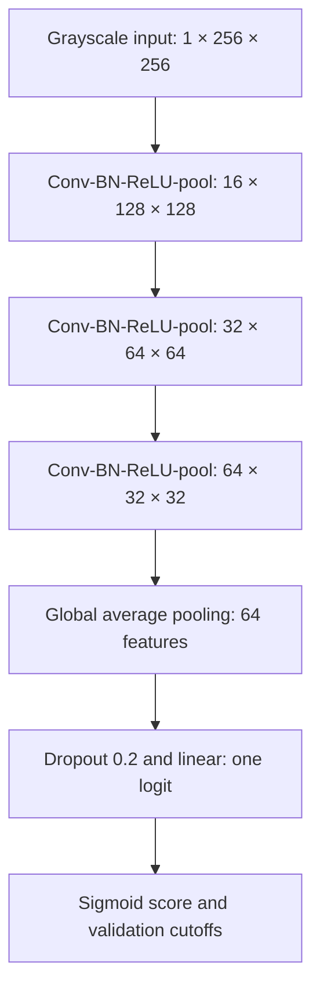

# Risk-Aware, Explainable Fabric Defect Detection for Textile Quality Control

**Report draft. Empirical coursework evidence remains incomplete.** The proposal was approved according to the student's confirmation. The software was rebuilt and verified on a clearly labelled synthetic development sample. No approved-dataset final comparison is reported here. Numerical sections marked NOT RUN must be completed from actual frozen experiment artifacts.

## Question 1 — Dataset and exploratory data analysis

### Application, intended user and decision

The intended user is a textile Quality Assurance Inspector. A prediction changes which fabric patch is reviewed routinely, receives manual review or is held for priority inspection. This is a garment-manufacturing application scenario; there is no claim of a company partnership, production deployment or validated factory cost model. An image patch cannot establish the quality of an entire roll. The inspector retains the decision.

### Approved dataset and target

The approved proposal uses RAW-FABRID V1, Mendeley Data, DOI 10.17632/db6g85xsyg.1, CC BY 4.0 [1]. The publisher describes 709 original grayscale images, 204 original defect masks and 19,852 256 × 256 patches. These counts are publisher descriptions until the release is audited locally. The actual archive was inaccessible here (HTTP 403); acquisition and schema audit remain outstanding.

The assessed target is binary: any annotated defect pixel makes a patch defective (1); explicitly confirmed absence of patch defects gives defect-free (0). A patch from a defective parent can still be normal. Missing masks alone do not establish normality. The import workflow checks the documented folder convention, aligned binary masks, complete patch-to-source mapping, byte/pixel checksums and actual release counts. Masks supply labels and XAI ground truth; they never enter the classifier input.

The publisher's train/good partition contains only normal patches. The approved supervised research protocol therefore uses the complete labelled patch collection and freezes a new source/duplicate-group split before development. Its results would not be directly comparable with the original anomaly-detection benchmark. Source image, physical roll, manufacturer and fabric type are not interchangeable. Unknown physical relationships limit generalisation claims.

### Development sample audit

The reference ZIP's metadata describes 1,568 synthetic patches, but only 100 referenced images are present; 1,468 are missing. Of 163 referenced defect masks, 123 are missing. The new development sample includes 100 present images, with 84 normal and 16 defective labels from four artificial source images. It is an engineering fixture, not an authentic sample of RAW-FABRID and not assessed dataset evidence.

The frozen development assignment has 56/28/16 train/validation/test patches and 2/1/1 independent source components. Integrity checks found no exact duplicate pixels and no confirmed near-duplicate pairs across different sources in the selected sample. Screening is not a guarantee against transformed crops or unrecorded physical relationships. No development held-out model evaluation has been run.

### Decision costs, metrics and EDA protocol

A missed visible defect may allow flawed material to continue through processing. A false positive adds avoidable manual inspection or delay. These are coursework assumptions; monetary factory losses are not known. Defect-class F2 is the primary metric because recall is weighted more heavily than precision. It is not a complete economic utility function. Report precision, recall, F1, missed defects, false-positive rate, confusion counts and score-based average precision/ROC-AUC where defined. Undefined precision/recall uses zero. Group bootstrap resamples independent components rather than treating related patches as independent.

The binary classification threshold maximises validation F2; ties favour precision and then the higher threshold. Inspection recommendations use separate validation-selected cutoffs under assumed costs: 10 for a low-band missed defect, 1 per manual review, and 3 per unnecessary normal-patch priority hold. Report review burden and low-band misses. The middle band is a decision rule, not a statistically established uncertainty interval. Calibration is optional and fitted outside test; scores are never presented as guaranteed confidence.

`scripts/eda.py` uses training images only for class/source counts, defect sizes, brightness, contrast, texture variation and representative image/mask plots. The three generated findings must be copied from the actual approved training-data statistics and linked to capacity/imbalance/resolution choices.

**Approved-dataset EDA and exactly three assessed evidence-backed findings: NOT RUN.** The supplied synthetic plots/findings demonstrate the workflow only.

## Question 2 — Solution design

### 2.a ANN architecture and individual design choices

The initial ANN is an understandable three-block CNN. Each block has a 3 × 3 padded convolution, BatchNorm, ReLU and 2 × 2 max pooling. Widths are 16, 32 and 64. Global average pooling, dropout 0.2 and a 64-to-1 linear layer produce one binary logit. The executed default model has **23,473 parameters**; the full layer/shape/activation table is generated from the actual PyTorch modules in the run record.

Convolution assumes useful local spatial patterns recur across positions, which suits periodic weave and local disruptions. Three blocks give increasing context while retaining a 32 × 32 feature map; two/four-block variants empirically examine depth. Modest widths limit capacity when independent sources are scarce. BatchNorm stabilises intermediate activation scales but can behave differently under acquisition shift; this remains a limitation. ReLU gives simple nonlinear features. Dropout regularises the classifier and is tested against a no-dropout alternative. Global averaging limits parameters but can dilute tiny local defects; that limitation must be examined empirically rather than dismissed.

A single logit with `BCEWithLogitsLoss` is numerically compatible with binary labels. Positive weighting, when enabled, comes from training class counts only; no additional weighted sampler is silently combined with it. Weighted/unweighted loss is compared, not assumed beneficial. At serving time the selected threshold is restored from validation selection, rather than reset to 0.5.

MobileNetV3-Small [2] is a compact transfer-learning candidate with an actual ImageNet-initialised backbone and a one-logit head. Fine-tuning updates all layers. Grayscale is replicated to three channels and normalised with the pretrained channel statistics. The classifier preserves the full 256 × 256 patch instead of copying the pretrained central crop that could discard an edge defect. This modification and natural-image domain mismatch require empirical validation. The selected architecture is whichever ANN has the best declared validation evidence, including retaining the initial model when appropriate.

**Final selected real-data architecture and its actual shape/parameter table: PENDING.**

### 2.b Alternatives and pre-evaluation expectation

| Alternative | When appropriate | Limitation for this task |
| --- | --- | --- |
| Local LBP/HOG + tuned SVM | Regular texture, limited independent data, modest CPU resources | Fixed descriptors cannot adapt their feature extraction |
| Small CNN trained from scratch | Sufficient labelled source variation and a need for interpretable design | Limited sources can overfit; tiny defects can be diluted |
| Compact pretrained CNN | Limited labels and reusable visual features | Grayscale industrial domain differs from natural-image pretraining |
| Vision transformer | More independent data or well-matched pretrained representations | Extra complexity/compute and unclear benefit at current evidence level |
| Anomaly detection | Mostly normal training observations with novel anomalies | Different objective/protocol from the approved supervised binary task |
| Segmentation | Precise defect localisation is the product decision | Larger assessed scope; classification explanation is not a segmentation claim |
| RNN/LSTM/GRU | Meaningful ordered image/sensor sequences | Independent still-image patches have no justified temporal sequence |

The pre-evaluation hypothesis predicts that fine-tuning may outperform fixed texture descriptors on F2 if independent source coverage is sufficient. Regular weave, tiny defects and limited source diversity could favour the SVM. This is a conditional hypothesis, recorded before final evaluation, not a claim that the ANN must win.

## Question 3 — Development, evaluation and optimisation

### 3.a Development and fair comparison

The PyTorch training loop follows the supplied teaching notebooks' model/optimizer/epoch structure, with validation replacing repeated test-set use. Losses are weighted by sample count. Checkpoints are selected by validation F2 with validation loss as a tie-breaker, and early stopping is recorded. Augmentation is limited to training flips that preserve patch content; aggressive resizing, cropping and blur are avoided.

The classical baseline uses spatial LBP histograms, with HOG as a feature alternative, a train-fitted StandardScaler and linear/RBF SVM. Its 24 configurations cover feature mode, kernel, C and class weighting. The ANN has 20 predeclared configurations. The budgets have comparable order of magnitude; report both configuration counts and compute time. Three predetermined seed runs assess selected-model variability before test access.

| Model | Real held-out F2 | Training time | End-to-end latency | Evidence |
| --- | --- | --- | --- | --- |
| Always normal | NOT RUN | No fitting | Measure/reference scope | Frozen shared test |
| Always defective | NOT RUN | No fitting | Measure/reference scope | Frozen shared test |
| Tuned texture SVM | NOT RUN | PENDING | PENDING | 24 real search logs |
| Initial CNN | NOT RUN | PENDING | PENDING | Initial real run |
| Selected final ANN | NOT RUN | PENDING | PENDING | Frozen selected real checkpoint |
| Real VLM | NOT RUN | Pretrained; local loading separately reported | PENDING | Actual model responses |

The executed development check is not this table. It trains a three-epoch CNN and one SVM on synthetic training data, saves/reloads the weights, produces request-time API predictions and validates explanations. Its narrow near-0.5 scores and many false positives show why software smoke success cannot be presented as a production model result.

After frozen real evaluation, characterise false positives/negatives by verified source/groups, defect size, contrast/texture and available acquisition metadata. Relate learning curves to under/overfitting, and retain every model's predictions. Do not use final errors to tune again. **Real error analysis: NOT RUN.**

### 3.b Optimisation evidence

AdamW combines adaptive per-parameter updates with decoupled weight decay; SGD with momentum accumulates directions and may need a different learning rate. The plan gives AdamW 1e-4/3e-4/1e-3/3e-3 and SGD 0.001/0.01/0.03/0.1 rather than forcing both to share one unsuitable rate. Batch sizes 16/32/64 and actual CNN depths 2/3/4 are studied under controlled settings. Alternatives test width, dropout, augmentation and loss weighting with plausible hypotheses.

**Empirical optimisation conclusions: NOT RUN on approved data. Four genuine unsuccessful attempts, including two substantive failed approaches and diagnoses: PENDING.** Neither fabricated historical outcomes nor syntax errors are counted. Each actual attempt must cite its configuration, control, validation evidence and lesson.

## Question 4 — Web application

The FastAPI backend loads the selected trained checkpoint once, checks its hash and preprocessing metadata, and serves a lightweight responsive interface. The inspector uploads a patch and receives a new score/class/recommendation with model identity and measured model/server-processing times. The explanation route computes actual Grad-CAM. The API never selects a sample by filename to return a stored prediction.

PNG/JPEG content, decoded size, channels and the 5 MiB limit are checked. Primary input is exactly 256 × 256; a full fabric photograph is not squeezed into one patch. Grayscale/RGB are accepted, transparency/animated inputs and invalid data rejected. Blank/noise inputs can still receive model scores; automated reliable OOD detection is explicitly not claimed. UI limitations warn about unseen fabrics, lighting, blur, phone photographs and tiny defects.

Synthetic weights require explicit opt-in and show a development warning. Missing/corrupted weights expose an unavailable state and HTTP 503. Tests compare fresh API results to direct forward passes through a genuinely trained checkpoint and test malformed/OOD inputs and preprocessing parity.

**Working software demonstrated on development data. Real trained deployment checkpoint and final end-user evaluation: PENDING.**

## Question 5 — Explainable AI

### 5.a Method comparison

| Method | What it explains | Dependence/cost | Important limitations |
| --- | --- | --- | --- |
| Grad-CAM [3] | Spatial influence on the defect logit at a convolutional layer | CNN activations/gradients; approximately one gradient computation | Coarse maps, layer sensitivity, zero positive CAM possible |
| Integrated Gradients [4] | Input attribution along a path from a chosen baseline | Differentiable model; multiple gradient steps | Baseline/path sensitivity; visual noise; not causal proof |
| LIME [5] | Local surrogate response to image-region perturbations | Model-agnostic; many forward passes | Superpixel/sampling instability and unnatural masked images |

Grad-CAM is selected for a lightweight inspector view because it aligns with the convolutional ANN and highlights regions rather than requiring the inspector to interpret individual feature vectors. Original and overlay appear together with opacity control. Its meaning is model attribution, not a certified defect boundary.

### 5.b Implementation and measurable checks

The target is the defect logit, including on predicted-normal images. The custom model uses its final ReLU before pooling to retain more spatial resolution. Hooks are removed and inference/gradient requests are serialised. A zero map stays zero. Spatial correspondence uses pointing hits and attribution mass inside nonempty masks, compared with area-based uniform/random references. Empty normal masks are handled separately.

Faithfulness is not inferred from overlap alone. A frozen 10% area is occluded at high-attribution, low-attribution and random positions with matched area and within-image channel-mean fill. Report defect-logit changes and controls; a negative drop means the score increased. Pixel deletion itself can create unnatural input. At least two real cases must be checked and **three genuine incorrect predictions must be analysed**, following the stricter final checklist.

The development run generated 28 validation explanations and 13 genuine false positives; three have inspected overlays and measured controls in `docs/development-xai-cases.md`. No false negative is invented. **Approved-dataset explanation validation and three assessed error case studies: PENDING.**

## Question 6 — Generative model application and comparison

### 6.a Real model protocol

The implemented candidate is SmolVLM-256M-Instruct [6], an image-capable local generative model, at immutable publisher revision `7e3e67e`. Its real processor receives the same underlying patch pixels. The prompt requests a binary JSON decision and no confidence. No labels, masks, revealing filenames, ANN outputs or test-derived hints enter inference. Two prompt candidates are evaluated on complete validation data before selection.

Logs preserve exact configuration, prompt, raw response, parsing errors/retries, tokens and measured processor/generation latency. A bounded single retry is declared in advance. Unresolved outputs remain in all denominators and conservatively count as an error for the true class. Class-only outputs do not support a continuous-score AUC or invented probability.

**Actual approved-data VLM application and final benchmark: NOT RUN.** The real local model was executed on one synthetic validation image as an adapter check. It produced malformed JSON, including on the declared retry, and was correctly retained as unresolved. Measured total CPU inference time for the two attempts was about 40 seconds. This small engineering check is not a full validation/test benchmark and establishes no real-fabric performance claim. Raw responses and resolved model revision are preserved; test doubles used in software tests are never reported as Q6 predictions.

### 6.b Comparative analysis and extension

| Dimension | Trained compact ANN | Local VLM |
| --- | --- | --- |
| Predictive F2/error pattern | PENDING shared-test evidence | PENDING shared-test evidence |
| Latency | PENDING real checkpoint/device measurement | PENDING processor/generation measurement |
| Monetary cost | Local hardware/electricity/training; not measured in money | No paid API used; local hardware/electricity still costs resources |
| Label requirements | Supervised training/validation labels | Pretrained model, validation labels for prompt selection/evaluation |
| Privacy | Local serving keeps upload content local | Local inference keeps pixels local once weights are acquired |
| Dependencies | Exact environment/checkpoint/input preprocessing | Large pretrained assets, processor/model revision and generation configuration |
| Deployment conditions | When domain evidence validates a fast task-specific classifier | When a general image-language capability adds measured value within compute limits |

Potential public-dataset pretraining contamination is unknown and must be discussed without asserting knowledge of the VLM's training corpus. A plausible extension is a short inspection note based on verified observations and measured model outputs, with human review. It must not invent manufacturing root causes, defect severity or roll-level conclusions. This extension is an opportunity, not an implemented or assessed substitute for the direct comparison.

## References

1. Pérez-Llorens, R., Albero-Albero, T., and Silvestre-Blanes, J. (2026). RAW-FABRID V1. https://data.mendeley.com/datasets/db6g85xsyg/1
2. Howard et al. (2019). Searching for MobileNetV3. Architecture/weights documentation: https://docs.pytorch.org/vision/stable/models/generated/torchvision.models.mobilenet_v3_small.html
3. Selvaraju et al. (2017). Grad-CAM: Visual Explanations from Deep Networks via Gradient-based Localization. https://arxiv.org/abs/1610.02391
4. Sundararajan, Taly, and Yan (2017). Axiomatic Attribution for Deep Networks. https://arxiv.org/abs/1703.01365
5. Ribeiro, Singh, and Guestrin (2016). Why Should I Trust You? Explaining the Predictions of Any Classifier. https://arxiv.org/abs/1602.04938
6. Hugging Face Smol Models team. SmolVLM-256M-Instruct model card. https://huggingface.co/HuggingFaceTB/SmolVLM-256M-Instruct

## Appendix — AI use and remaining verification

AI assistance was used for proposal interpretation, code rebuilding, debugging, test design, notebook adaptation and this report draft. This development aid is separate from the assessed real VLM in Q6. The student must review the source, reproduce the approved-data experiments, validate every result/interpretation/citation, understand the code and complete the individual demonstration/presentation. See `docs/ai-use-declaration.md`. The final report must be rendered and checked to remain at most 25 pages excluding appendices.
